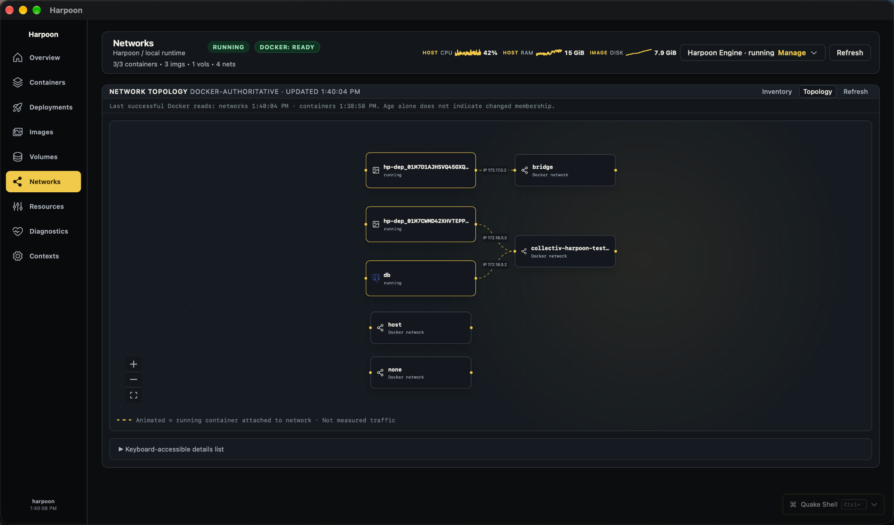

# Harpoon

**From repository to running app. All on your Mac.**

Harpoon is a native macOS workspace for Docker-compatible containers and **attended, local source deployments**. Run containers and Compose projects, or build an application from a Git repository and manage its releases on the same Mac—without requiring Docker Desktop, Kubernetes, or a cloud account. Apple's `Virtualization.framework` runs the lightweight Linux guest; Docker Engine remains responsible for containers, images, networks, volumes, and builds.

**[Download Harpoon 2.0.0-rc.4 for macOS (testing prerelease)](https://github.com/krazybean/Harpoon/releases/download/v2.0.0-rc.4/Harpoon-2.0.0-rc.4-universal.dmg)** · [Latest stable v0.1.1 (Apple Silicon)](https://github.com/krazybean/Harpoon/releases/tag/v0.1.1) · [Release notes](https://github.com/krazybean/Harpoon/releases/tag/v2.0.0-rc.4) · [Screenshots](assets/screenshots/README.md)

> **Before you install:** rc.4 is a **testing prerelease**, not a stable 2.0 release. **Apple Silicon is the only tested platform**; Intel binaries and a guest are included, but Intel boot has not been verified. macOS 12 or later is required. The shipped desktop has not yet passed installed first-launch acceptance; back up existing Harpoon data and use disposable workloads. [What was actually tested](docs/releases/v2.0.0-rc.4.md#verification).


*Deployments Overview, captured from a development build with local applications—not a separately accepted screenshot of the shipped rc.4 desktop. [See all screenshots and their provenance](assets/screenshots/README.md).*

## Install and try Harpoon

**1. Download and verify the DMG.** The released, notarized and stapled `Harpoon-2.0.0-rc.4-universal.dmg` has SHA-256:

```text
7dd7cbf2a190f192a886419b1ee84cf38c34ad9f557d0d7c9af8a55e45608d51
```

In Terminal, from the folder containing the downloaded DMG:

```sh
shasum -a 256 Harpoon-2.0.0-rc.4-universal.dmg
```

Compare the output with the value above or the attached [`SHA256SUMS`](https://github.com/krazybean/Harpoon/releases/download/v2.0.0-rc.4/SHA256SUMS). If it differs, **do not install**.

**2. Install the app.** Open the DMG and drag **Harpoon.app** to **Applications**. The release is Developer ID signed and Apple-notarized; you should not have to disable Gatekeeper. When launched from Applications, Harpoon offers to register its bundled `harpoon` and `docker` commands for new Terminal windows; that optional step requires an administrator password. You do **not** need to install Docker Desktop, Node.js, Rust, or Xcode to run the packaged app.

**3. Start the local runtime and try Docker.** Start Harpoon from its desktop window. If you accepted the CLI registration, open a **new** Terminal window and run:

```sh
harpoon status
harpoon doctor
docker --context harpoon version
docker --context harpoon run --rm hello-world
```

The `harpoon` context uses Harpoon's local socket; using `--context harpoon` does not change your existing default Docker context. The first image pull needs network access. The desktop can manage containers even if you decline optional Terminal-path registration. If CLI discovery or context setup fails, see [installation and troubleshooting](docs/installation.md).

**Already using Harpoon?** Back up `~/Library/Application Support/Harpoon` **and** `~/Library/Application Support/com.harpoon.desktop` before trying rc.4. Upgrading and rolling back this prerelease have not yet been accepted as safe workflows. [Backups, data locations and removal](docs/installation.md#data-upgrades-and-removal).

## What you can do

### Containers and Compose

- Run Docker-compatible workloads through Docker Engine in an Alpine Linux VM; use the standard Docker context, CLI, image and volume workflows.
- Inspect containers, images, networks and volumes in the desktop. Manage Compose projects and view network topology and diagnostics.
- Check the root disk, expand it **only with confirmation**, and reclaim unused guest disk blocks without deleting Docker data. A new disk defaults to 4 GiB logical (sparse); existing disks are preserved.

### Local application deployments

- Register a Git source or local checkout. Deploy a Dockerfile project or use a generated build recipe for supported **npm** and **Python (pip/uv)** projects.
- Configure build and start behavior, environment variables and macOS Keychain-backed secrets. Build secrets use BuildKit secret mounts on supported generated builds.
- Confirm each live deployment or replacement; review the recorded build, preliminary check, cutover and final health evidence.
- View history and the serving container's Docker metrics, and use explicit rollback or Rebuild & Restore operations when applicable. Cleanup of old release artifacts requires confirmation.

**Boundaries matter:** Harpoon deploys to **this Mac**, not Vercel or a remote server. It does not auto-deploy on push, provide public cloud hosting, guarantee zero downtime, or create per-branch preview environments. Development/Preview environment cards in example screenshots are not promises of available environments. All live deployment actions are attended. [Deployment requirements and limits](docs/deployment-control-plane-requirements.md).

## Why Harpoon?

| | Harpoon today |
|---|---|
| **Runtime** | Native macOS VM using Apple's Virtualization.framework, with Docker Engine inside the Linux guest. |
| **Workflow** | Containers and Compose alongside a source-to-local-app deployment workspace. |
| **Control** | Explicit deploy, rollback, disk-growth and cleanup decisions; local Docker context rather than a separate container-engine API. |
| **Scope** | One Mac, with evidence and documented limitations instead of a claim of Docker Desktop, Vercel, or Kubernetes feature parity. |

Harpoon is built for developers who want a straightforward local runtime **and** a path from source code to a running app. It is not a replacement for production orchestration or managed hosting.

## Screenshots

| Deployments metrics | Network topology |
|---|---|
|  |  |
| Docker-reported CPU, memory, network and uptime for a serving release, with session-only history. | Container-to-network attachment; animated links do not represent measured traffic. |

[View the full screenshot gallery, including capture context](assets/screenshots/README.md) · [Watch the Harpoon 2.0 teaser](https://github.com/krazybean/Harpoon/releases/download/v2.0.0-rc.1/Harpoon-2.0-teaser-v2-15s.mp4) (older preview video).

## Compatibility, safety and known limitations

| Platform | Current status |
|---|---|
| Apple Silicon Mac, macOS 12+ | Target platform; packaged runtime smoke-tested on Apple Silicon. |
| Intel Mac, macOS 12+ | Universal binaries included, but **Intel guest boot not verified**; experimental, not supported. |
| Windows / Linux hosts | Not supported. |

The rc.4 package's **Apple Silicon runtime** booted in an isolated test, ran an Alpine container and recovered Docker after three engine hard kills. The **shipping desktop app was not installed or launched for acceptance**. A clean install on a second Mac, Intel boot, two-Mac/60-cycle reliability, upgrade/rollback, and a deployed app running through the packaged desktop remain unverified. Intermittent guest faults and `VZErrorDomain 1` startup failures remain known risks; the available evidence does **not** establish their cause or eliminate them.

Existing applications deployed before the lifecycle fix retain restart policy `no` until the separately authorized migration is performed. Removing Harpoon.app does not automatically remove your persistent Docker disk, deployment journal or Keychain secrets. Read [installation, backups and troubleshooting](docs/installation.md) before upgrading, removing or troubleshooting an installation.

Security issues should be reported privately via the [security policy](SECURITY.md), not as public issues. [Read release acceptance details](docs/releases/v2.0.0-rc.4.md) and [compatibility notes](docs/compatibility.md).

## Releases and development

| Release | Status |
|---|---|
| [v2.0.0-rc.4 universal DMG](https://github.com/krazybean/Harpoon/releases/tag/v2.0.0-rc.4) | **Current testing prerelease**, signed and notarized; Apple Silicon tested, Intel experimental. |
| [v0.1.1 arm64 DMG](https://github.com/krazybean/Harpoon/releases/tag/v0.1.1) | **Latest stable** desktop release. |
| [All releases](https://github.com/krazybean/Harpoon/releases) | Historical prereleases and their actual attached assets; rc.2 has no downloadable DMG. |

To **build or contribute** rather than install the DMG: [Building](docs/building.md) · [Contributing](CONTRIBUTING.md) · [Architecture](docs/architecture.md) · [Roadmap](docs/roadmap.md) · [Measurements](docs/performance.md) · [Validation evidence](docs/results/) · [License](LICENSE). Technical measurements are observations from documented setups, **not** general performance guarantees.

Documentation presentation decisions and intentional deferrals are recorded in [README presentation decisions](docs/readme-presentation-decisions.md).
