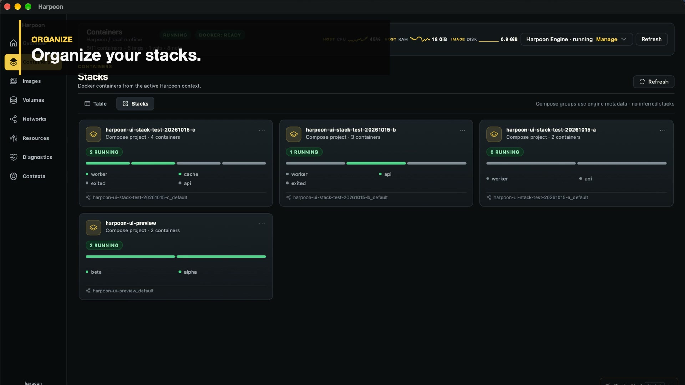
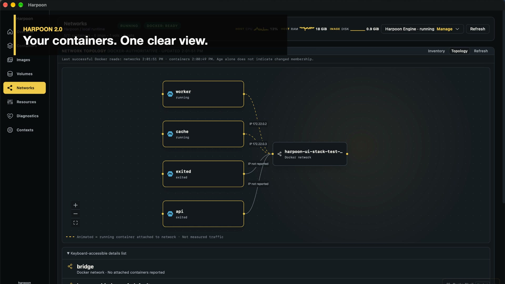
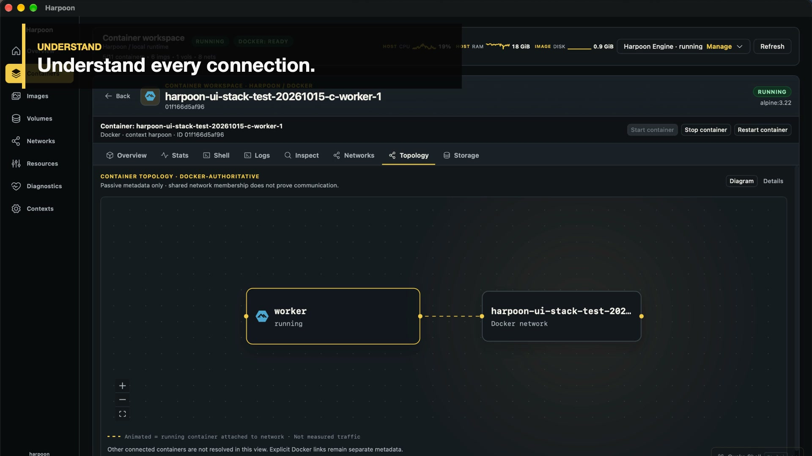
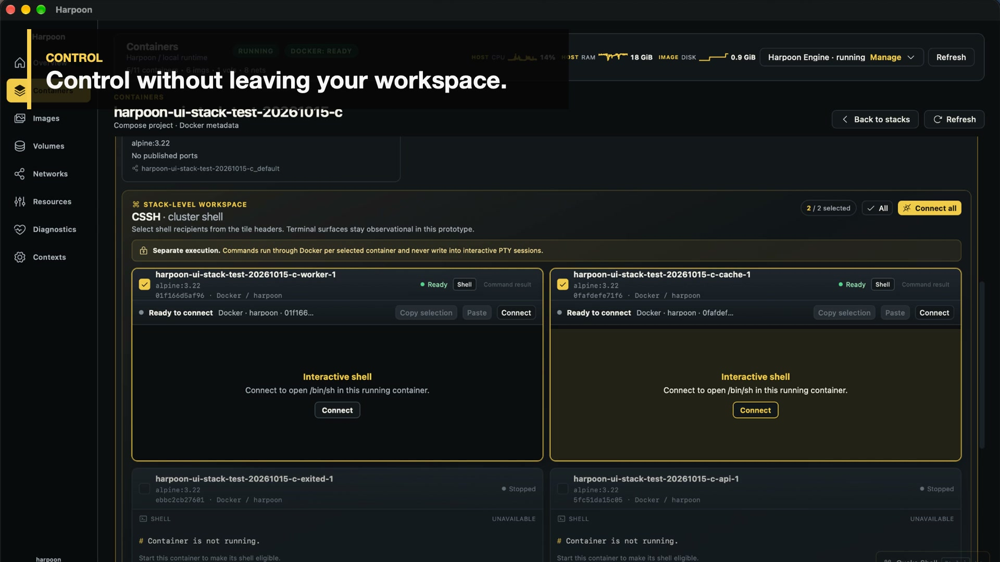

# Harpoon 2.0

*Containers, under control.*

A native macOS workspace for managing Docker-compatible containers, Compose stacks, networks, and development environments without Docker Desktop. Harpoon uses Apple's `Virtualization.framework` and a minimal Linux VM while keeping Docker Engine authoritative for container workloads.
[](https://github.com/krazybean/Harpoon/releases/latest)
[](https://github.com/krazybean/Harpoon/actions/workflows/codeql.yml)
[](https://securityscorecards.dev/viewer/?uri=github.com/krazybean/Harpoon)
[](https://github.com/krazybean/Harpoon/blob/main/LICENSE)
[](https://github.com/krazybean/Harpoon)


Harpoon runs ordinary Docker development workloads on macOS without requiring Docker Desktop. The host runtime owns the macOS↔Linux boundary; Docker Engine, containerd, and BuildKit remain inside the guest.

## Harpoon 2.0 teaser

[](https://github.com/krazybean/Harpoon/releases/download/v2.0.0-rc.1/Harpoon-2.0-teaser-v2-15s.mp4)

The 15-second [Harpoon 2.0 desktop teaser](https://github.com/krazybean/Harpoon/releases/download/v2.0.0-rc.1/Harpoon-2.0-teaser-v2-15s.mp4) is attached to the [v2.0.0-rc.1 prerelease](https://github.com/krazybean/Harpoon/releases/tag/v2.0.0-rc.1) (it is not attached to rc.2 or rc.3). GitHub README pages use a linked thumbnail so the video remains a reliable release download.

## Why Harpoon?

- **Native macOS integration** — built directly on `Virtualization.framework` (no bundled third-party hypervisor).
- **Docker-compatible workflow and API** where actually supported — `docker`, `compose`, and related tools speak to Harpoon's API through a standard Unix socket / Docker context.
- **Deliberately small architecture** — minimal Linux appliance guest, host control plane focused on VM lifecycle, socket bridging, networking, bind-mount transport, and diagnostics.
- **Transparent and inspectable** — source available, documented build from Swift and Tauri, no hidden updater or launch agent.

Harpoon does not replace Docker Engine. Docker Engine, containerd, and BuildKit remain authoritative inside the guest for containers, images, volumes, networks, and builds. Harpoon owns the macOS↔Linux boundary.

## Downloads: stable versus testing

| Release | Status | Downloadable assets |
|---|---|---|
| [**v0.1.1**](https://github.com/krazybean/Harpoon/releases/tag/v0.1.1) | **Latest stable** desktop release | `Harpoon-0.1.1-arm64.dmg`, `SHA256SUMS` |
| [**v2.0.0-rc.3**](https://github.com/krazybean/Harpoon/releases/tag/v2.0.0-rc.3) | **Testing prerelease**, not stable 2.0.0 | `Harpoon-2.0.0-rc.3-universal.dmg`, `SHA256SUMS`, `SIGNING-PROVENANCE.txt` |
| [v2.0.0-rc.2](https://github.com/krazybean/Harpoon/releases/tag/v2.0.0-rc.2) | Superseded prerelease | **None.** The release page exists but has no attached files. |
| [v2.0.0-rc.1](https://github.com/krazybean/Harpoon/releases/tag/v2.0.0-rc.1) | Superseded prerelease | `Harpoon-2.0.0-rc.1-arm64.dmg`, teaser video. Not recommended. |
| [v0.1.0](https://github.com/krazybean/Harpoon/releases/tag/v0.1.0) | Older stable | DMG and the standalone CLI/runtime archive `harpoon-0.1.0-darwin-arm64.tar.gz` |

A standalone v0.1.1 CLI archive is not published. The Releases page is the authoritative list of artifacts.

### v2.0.0-rc.3 (testing prerelease)

- **File:** [`Harpoon-2.0.0-rc.3-universal.dmg`](https://github.com/krazybean/Harpoon/releases/download/v2.0.0-rc.3/Harpoon-2.0.0-rc.3-universal.dmg), 359,125,680 bytes.
- **SHA-256:** `fdf3141e0b6af296b6748035b2b6182b56876bff526700e0197ff0daede1ffab`. This is the only checksum to verify: the hash of the final, notarized and stapled file (`shasum -a 256 Harpoon-2.0.0-rc.3-universal.dmg`, or `SHA256SUMS`). Other hashes in the release notes describe build inputs.
- **Signing:** Developer ID signed (JUAN G CASTRO, LPX4W69ZH8), notarized by Apple (submission Accepted) and stapled. Gatekeeper accepted a download-style (quarantined) copy of the DMG and the app inside it.
- **Purpose:** a compatibility release. It adds the reader for journal schema 2 (see [Compatibility and removal](#compatibility-and-removal-in-rc3)). It is for testing, not production.
- **Packaged for:** Apple Silicon (arm64) and Intel (x86_64), as one universal app. Only Apple Silicon has been run (below).
- **Requires:** macOS 12 or later.

**Tested.** The runtime packaged in this DMG, run in an isolated test namespace on Apple Silicon, booted its guest, reached Docker-ready and ran an Alpine container (`docker run --rm alpine:3.20 echo SMOKE_OK`).

**Not verified.**
- **The shipping desktop app has not been installed or launched in acceptance.** Its sockets and lock files are shared with a running production engine, so it could not be isolated safely on the test Mac. The first-launch experience and the desktop's behavior on an existing journal are covered only by build-time checks and CI tests.
- **Intel:** the Intel binaries are packaged and verified at the binary level, but no Intel guest has been booted and no Intel Mac was used. The x86_64 guest also predates the guest-DNS fix that the arm64 guest has.
- Upgrade from rc.1 or rc.2, a second Mac, repeated cold boots, and a clean-machine install.

**Installing.** The expected steps are: download the DMG, verify the SHA-256, open the DMG and copy Harpoon to `/Applications`. Because the image is notarized, Gatekeeper is expected to open it without an override; do not disable Gatekeeper. On first launch from `/Applications`, Harpoon asks once for an administrator password to add its `docker` and `harpoon` commands to your Terminal PATH (see [Requirements](#requirements)). These steps have not been run on a clean machine. Use disposable containers, and keep a copy of `~/Library/Application Support/Harpoon` and `~/Library/Application Support/com.harpoon.desktop` before trying a prerelease; moving back from rc.3 to an earlier prerelease has not been tested.

More detail: [rc.3 release notes](docs/releases/v2.0.0-rc.3.md) and the [release page](https://github.com/krazybean/Harpoon/releases/tag/v2.0.0-rc.3).

### Compatibility and removal in rc.3

- **Registration removal ("Remove registration…") and application removal ("Remove application…") are implemented but closed in every shipping build**, rc.3 included; the Settings controls are disabled and show the reason. Application removal v1 would apply only to applications that were never deployed. Nothing in rc.3 enables either operation.
- rc.3 reads deployment-journal schema 1 (every journal today) and schema 2, the format used once a removal has been recorded. rc.3 never writes schema 2, so using it does not change your journal's format.
- **Downgrade limit for a later release.** If a later release that enables removal records one, a journal at schema 2 cannot be opened by a build older than rc.3: it stops with `invalid SQLite record` and leaves the journal unchanged. Move every installation that can open the journal to rc.3 or later before enabling removal.

Source builds remain available for contributors: `bash harpoon/build.sh` (see [Building](docs/building.md)). Use the Releases page above as the authoritative list of published artifacts.

## Desktop workspace

The Tauri/React desktop app is a client of the Harpoon runtime. These captures were committed on 2026-10-17, before rc.2 and rc.3; they have not been re-checked against the rc.3 build, so they may not match it exactly:

| Stacks | Network topology |
|---|---|
|  |  |

| Container details | CSSH cluster shell |
|---|---|
|  |  |

The workspace also includes Overview, Quake Shell, and read-only Context Discovery surfaces, and a Deployments area (live deployment is closed in the current builds; history, releases, configuration and logs are readable). Their current behavior and acceptance status are documented in [the UI notes](docs/ui/README.md), [Context Discovery](docs/context-discovery.md), and [the Harpoon 2 roadmap](docs/roadmap.md). The older images under `docs/ui` remain visual references, not runtime screenshots.

## Harpoon 2.0 RC capabilities

The items below were demonstrated on the documented test system (see results), mostly on the source-built CLI and runtime, not by installing the rc.3 DMG. Fresh-start DNS validation has passed — see below.

- **CLI & lifecycle:** `harpoon start` / `stop` / `restart` / `status` / `logs` / `run` / `version` / `help`; background lifecycle via `Process`, single instance via `flock` on `/tmp/harpoon.lock`, PID safety via `proc_pidpath`, stale recovery, terminal independence.
- **Docker integration:** socket at `unix:///tmp/harpoon-docker.sock` (`0600`), Docker context `harpoon` (`harpoon docker setup|status|use`), `docker --context harpoon version/ps/run/build/buildx` works without TCP.
- **Compose & dev workflow:** `compose build/up/down`, bind mounts (`ro` enforcement, named volume `pgdata` persistence), bridge `m9net` + DNS, published ports, `env`/`.env`/`healthcheck`/`scale`/`mem_limit`.
- **Networking:** VZNAT + virtio-net, host loopback forwarder for published ports (`docker run -p 8080:80` → `curl 127.0.0.1:8080`), `/tmp/harpoon-share` VirtioFS bind mounts, `net.ipv4.ip_forward=1`.
- **Installation / distribution:** relocatable `dist/harpoon-0.1.0-darwin-arm64` (historical, v0.1.0) (bin 802K, kernel 33M, initramfs 14M, root 2G sparse), `harpoon/install.sh` to `/usr/local`, `uninstall.sh`, APFS clone-aware `cp -c` provisioning, ad-hoc signing with `com.apple.security.virtualization` for the source-built CLI. (The rc.3 DMG is separately Developer ID signed and notarized; see Downloads.)
- **Desktop workspace:** Tauri 2 + React + Vite with Overview, container table and Compose Stacks, container details, network topology, CSSH cluster shell, Quake Shell prototype, and read-only Context Discovery. Prototype and acceptance-pending surfaces are labeled in the UI and docs.
- **Ecosystem compatibility:** matrix A–H via `harpoon/ec-test.sh` (when host healthy) — compose, contexts, buildx verified; specific matrix rows preserved as `BLOCKED` only by host transient, not product.
- **Validation:** dense acceptance harnesses (M7–M18, EC, UI, D1/D1.1) with logs, `tier-status.csv`, and preserved historical evidence.

Fresh-start DNS validation (clean stop → fresh `harpoon start` → Docker Engine 28.3.3 `linux/arm64` ready → guest `resolv.conf` with working external resolvers → `registry-1.docker.io` resolved → uncached `busybox:1.37` pull succeeded) **now passes**, superseding earlier documentation that described it as pending due to a Virtualization.framework host condition.

## Architecture

Conceptual data flow:

```
Docker CLI / client
        |
Harpoon host socket/API  (unix:///tmp/harpoon-docker.sock → vsock:2375)
        |
macOS Harpoon runtime (harpoon/Sources — Swift, Virtualization.framework)
        |
Virtualization.framework (VZVirtualMachine, VZLinuxBootLoader, VZNAT, VirtioFS, vsock)
        |
Linux VM (Alpine 3.22, Docker Engine 28.3.3, containerd)
        |
Docker Engine / container runtime
```

Harpoon's control plane is deliberately small. Container execution, image management, and orchestration remain inside the Linux VM under Docker Engine.

For component boundaries and transport details, see [Architecture](docs/architecture.md) and [Lifecycle](docs/lifecycle.md).

## Requirements

- To run: macOS 12 or later on Apple Silicon (the tested platform). The rc.3 DMG also contains Intel binaries, but Intel guest boot is unverified.
- To build from source: Xcode Command Line Tools and Rust stable.
- **Docker CLI bundled**, Docker Desktop **NOT required**. Harpoon.app ships Docker's official CLI (pinned in `harpoon/fetch-docker-cli.sh`) and uses it only when no runnable `docker` is installed. On first launch from /Applications, Harpoon asks once for an administrator password to add its bin folder (bundled `docker` and `harpoon`) to `/etc/paths.d/harpoon`, after Homebrew and `/usr/local/bin`, so new Terminal windows find both commands; a declined prompt is not repeated. Docker Compose v2 plugin (`docker compose version`) required only for `compose` workflows. Harpoon discovers a runnable Docker CLI via `PATH` → `/opt/homebrew/bin/docker` (Finder-safe), rejecting stale or incompatible executables, and creates/repairs context `harpoon` → `unix:///tmp/harpoon-docker.sock` without changing your default context (`harpoon docker setup`; desktop ensures on first use). If `~/.docker/config.json` contains `"credsStore":"desktop"` without `docker-credential-desktop`, `harpoon doctor` warns (Harpoon never deletes `credsStore`).
- **Persistent storage**: immutable `assets/guest/harpoon-root.img` template (`2 GiB` sparse, `0/0/0`) → mutable `~/Library/.../harpoon-root.img` (grow-only sparse, never silently replaced). First provision **4 GiB** logical sparse (provisional default; larger workloads such as `azure-sql-edge` exhausted 2G, so Harpoon warns when space runs low and offers a user-confirmed expansion, see `docs/configuration.md`) via `harpoon start --disk-size 16G` or `harpoon config set disk-size`; grow via `harpoon disk resize 16G` (VM stopped, `truncate` + guest `resize2fs`, atomic, `backing>FS` retry).

## Quick Start

Shortest verified path (see [Building](docs/building.md) for prerequisites, packaging, signing, and troubleshooting):

```sh
# Prerequisites: macOS on Apple Silicon, Xcode Command Line Tools, Rust stable
git clone https://github.com/krazybean/Harpoon.git
cd Harpoon

# Build runtime
bash harpoon/build.sh

# Start Harpoon (defaults: cpus 2, memory 4096 MiB)
harpoon/build/harpoon start
harpoon/build/harpoon status
harpoon/build/harpoon docker setup

# Use Docker through Harpoon
docker --context harpoon version
docker --context harpoon run --rm hello-world
docker --context harpoon run --rm alpine:3.22 true

# Stop when done
harpoon/build/harpoon stop
```

After `harpoon/install.sh`, the same commands are available as `harpoon start/stop/status/...` from any directory and without a checkout. Detailed prerequisites and release packaging (Tauri app, DMG) are in [Building Harpoon](docs/building.md).

## Desktop Application

`ui/harpoon-desktop` is a Tauri 2 + React + TypeScript + Vite app. It is a client of the Harpoon runtime: it reads `status --json`, `doctor`, `logs` and `config`, and it starts, stops and restarts the runtime by running the bundled `harpoon` command. The VM itself is owned by the `harpoon` runtime process, not by the desktop window.

Currently implemented views include overview, containers, images, volumes, networks, resources, diagnostics and Deployments. Features include 750 ms bootstrap polling, 3 s periodic polling throttled when hidden, async `counts_cache` coalescing, binary resolver (`HARPOON_BIN` → bundled → `harpoon/build/harpoon` → `/usr/local/bin/harpoon`), and Docker resource counts via the Harpoon socket.

Build in development:

```sh
cd ui/harpoon-desktop
npm ci
npm run tauri dev
```

See [Building](docs/building.md) for release builds (`npm run build:release`).

## Resource Usage / Validation

Representative measurements from the documented test system (Mac15,6 M3 Pro, 18 GiB, macOS 26.5.2, Docker 28.3.3) — observations, not guarantees:

- **Host control plane at idle (30 s, 15 samples):** runtime daemon ~12 MiB RSS, desktop UI ~69–71 MiB RSS, combined ~80–83 MiB. Apple Virtualization.framework XPC service ~86–100 MiB observed separately. See README's earlier “Benchmark note” for full methodology.
- **Earlier feasibility comparison (different methodology, not interchangeable):** Harpoon VM ~386 MiB idle vs Docker Desktop ~954 MiB; under nginx+Redis+Postgres workload Harpoon ~919 MiB vs ~1.76 GiB.

Guest/container memory depends on workload and is not inferable from XPC RSS alone.

Collected evidence under `docs/results` and `harpoon/results` (M13–M18, R1, EC, UI, D1/D1.1) with `tier-status.csv`, `host.csv`, logs, and preserved healthy vs `HOST_VZ_START_FAILURE` windows.

For the repository-level build/test gate used by contributors and pull requests, run:

```sh
sh tools/validate.sh
```

Links: [Performance](docs/performance.md), [Resources](docs/resources.md), [Validation results](docs/results/), [Architecture](docs/architecture.md).

## Security & Trust

Harpoon intentionally exposes inspectable signals rather than claiming security:

- Source available for inspection
- [Security policy](SECURITY.md) with private disclosure guidance
- [Contributing guide](CONTRIBUTING.md)
- Dependency graph enabled, Dependabot alerts (including malware alerts) and security updates enabled
- Dependabot configuration for `npm`, `cargo`, and `github-actions`
- Repository configuration for **CodeQL** (javascript-typescript, rust with `build-mode: none`, Swift using the canonical production runtime build on `macos-latest`) and **OpenSSF Scorecard** (`v2.4.4`, pinned Actions)
- Pinned GitHub Actions (`actions/checkout`, `actions/setup-node`, `github/codeql-action/*`, `ossf/scorecard-action`, `actions/upload-artifact`) to commit SHAs

Harpoon includes repository configuration for CodeQL (javascript-typescript, rust, swift) and OpenSSF Scorecard. The repository is now public.

Automated analysis does not establish that Harpoon is safe, malware-free, or vulnerability-free. See [SECURITY.md](SECURITY.md) for scope, boundaries, and reporting.

## Known Limitations / v0.1 Scope

- **Platform:** Apple Silicon with ARM64 Linux guests is the supported 2.0 release target and the only tested platform. The universal DMG packages Intel binaries and an x86_64 guest, but Intel guest boot has not been verified, so Intel is experimental and unsupported. Windows/Linux hosts are unsupported. Podman/rootless is not a 2.0 gate.
- **Occasional VM startup condition:** An occasional host-side Virtualization.framework VM startup condition has been observed and characterized (see `docs/results/R1.md` for detailed evidence). The same build has been observed to start successfully; the condition is attributed to host/Virtualization.framework state rather than Harpoon packaging. Startup retries are bounded.
- **Distribution signing:** the v2.0.0-rc.3 DMG is Developer ID signed, notarized and stapled. Earlier prereleases and source builds are ad-hoc signed (`com.apple.security.virtualization`) and are not notarized.
- **Deployments:** live deployment, replacement and rollback are closed in shipping builds, as are registration removal and application removal.
- **Updates:** currently planned after a fresh build and restart; live reconfigure is not claimed.
- **Disk:** 2 GiB template + 4 GiB sparse default `harpoon-root.img` (provisional; APFS clone-aware, grown on request via `harpoon disk expand` or `harpoon disk resize`; existing disks keep their size). Bounded at ~962 MiB–1.0 GiB allocated; `growable` was rejected intentionally.
- **Network/FS:** explicit `127.0.0.1` HostIp binding deferred ( `0.0.0.0` → `127.0.0.1` is the safe default); `inotify` host→guest not propagated (documented).
- **Memory reclamation:** virtiomem balloon device and guest driver present, but host-visible reclamation was not consistently demonstrated across the measured tiers; v0.1 does not market balloon as a guaranteed host RSS reduction.
- **Sandbox on this dev host:** `~/Library/Application Support/Harpoon/data` creation is blocked by the host sandbox (`Operation not permitted`); production uses that path, with fallback to `/tmp/harpoon-runtime/data` for tests. Also, no universal performance guarantee beyond the observed environment.

## Documentation

| Document | Purpose |
|---|---|
| [Building](docs/building.md) | Canonical build, packaging, signing, verification |
| [Security Policy](SECURITY.md) | Supported versions, disclosure process |
| [Contributing](CONTRIBUTING.md) | Bugs, PRs, build reference |
| [Roadmap](docs/roadmap.md) | Milestones and current position |
| [Architecture](docs/architecture.md) | Components, boundaries, data flows |
| [Results](docs/results/) | Validation evidence (M13–M18, R1, D1) |
| [Resources](docs/resources.md) | Resource usage and diet limits |
| [UI](docs/ui/README.md) | Screenshots and visual-language notes |

## Status

Harpoon v2.0.0-rc.3 is a testing prerelease, not a stable 2.0.0 release. It is
Developer ID signed, notarized and stapled, and the runtime packaged in it passed
an Apple Silicon Docker smoke test. Still open: installation and first-launch
acceptance of the shipping desktop, Intel guest boot, second-Mac acceptance,
2×30 cold boots, and upgrade/rollback with persistent state preserved. Harpoon
v0.1.1 remains the latest stable desktop release.

The 2.0.0 release is being prepared (version set, [draft notes](docs/releases/v2.0.0.md)); it is not tagged, signed or published, and its clean-install and signing/notarization gates are open.

Artifacts are published on the repository Releases page. Source builds remain supported via `bash harpoon/build.sh` (see [Building](docs/building.md)).

## License

MIT — see [LICENSE](LICENSE).
