# Harpoon screenshot gallery

[← Back to the Harpoon README](../../README.md)

Fourteen screenshots of the Harpoon desktop app, grouped by area. They were captured from a **development build of the 2.0.1 feature branch** (`feat/2.0.1-source-deployments`) on a Mac running Harpoon with two locally deployed applications. The container-runtime screens exist in the [v2.0.0-rc.3 testing prerelease](../../README.md#downloads-stable-versus-testing); the source-deployment screens, container metrics and Docker artifact cleanup are **unreleased** work (see [unreleased changes](../../docs/releases/unreleased.md)), so the rc.3 app may look different.

**Contents:** [Runtime overview](#runtime-overview) · [Containers and Compose](#containers-and-compose) · [Source deployments](#source-deployments) · [Operations and metrics](#operations-and-metrics) · [Images, networking, and resources](#images-networking-and-resources) · [Engine discovery](#engine-discovery)

Everything shown runs locally on this Mac. Container names, ports, paths and sizes are from the capture machine.

---

## Runtime overview

### Overview

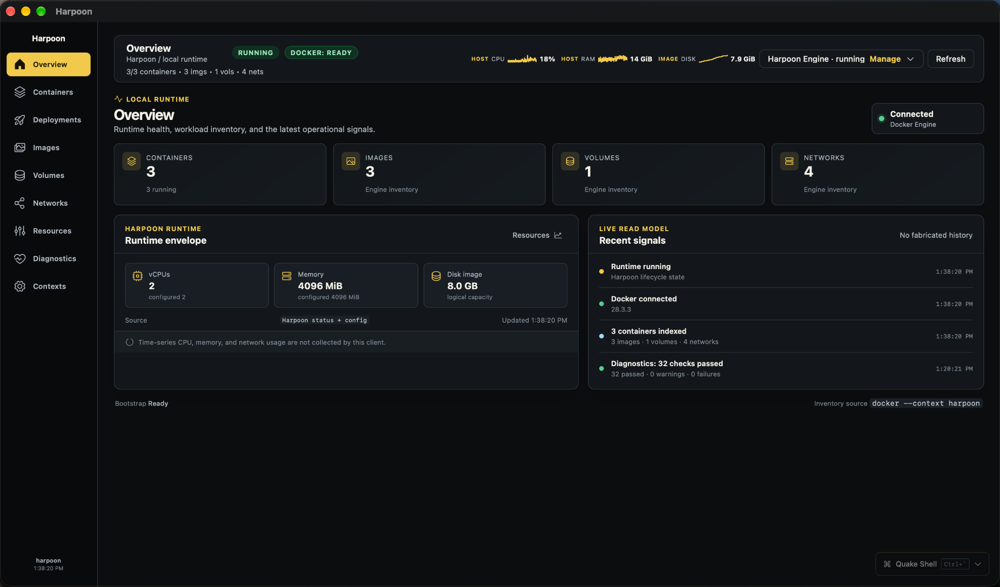

The landing view. It shows the runtime and Docker status, inventory counts from Docker (3 containers, 3 images, 1 volume, 4 networks), the configured runtime envelope (2 vCPUs, 4096 MiB memory, an 8 GB logical disk image), and recent signals such as the last diagnostics run (32 checks passed). It states that time-series CPU, memory and network usage are not collected by this view; per-container figures are in the deployment Metrics tab.

---

## Containers and Compose

### Containers: Stacks

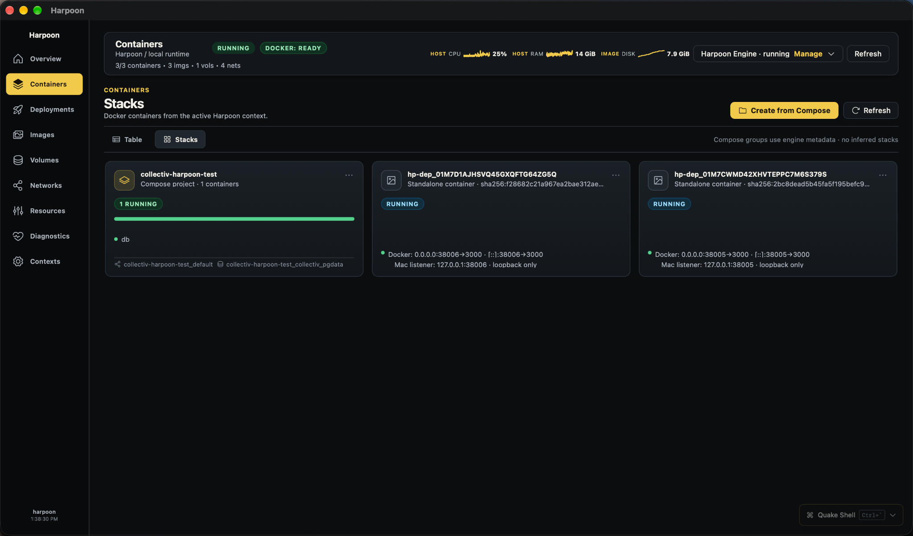

The Stacks view groups containers by the Compose metadata Docker reports; nothing is inferred. It lists one Compose project and two standalone containers (the containers of the two deployed applications). For published ports it shows Docker's mapping next to the listener actually bound on the Mac, here loopback only. **Create from Compose** starts a project from a Compose folder.

### Compose project workspace

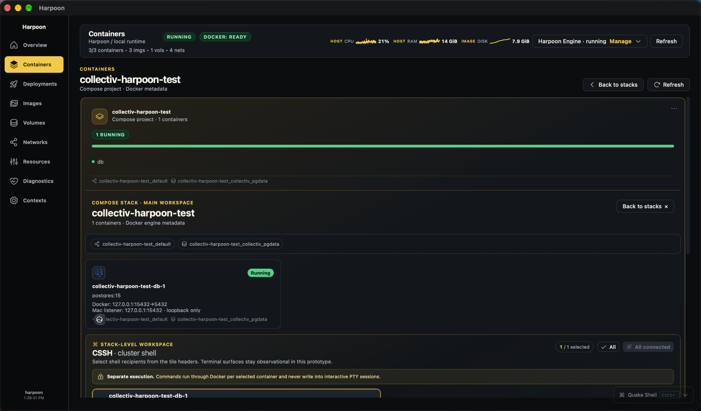

A single Compose stack opened as a workspace: running state, the project's network and named volume, a container card (image, published port, Mac-side listener) and the **CSSH** cluster shell for the stack. The shell is labeled a prototype, and its commands run through Docker per selected container rather than writing into interactive terminal sessions.

### Container shell

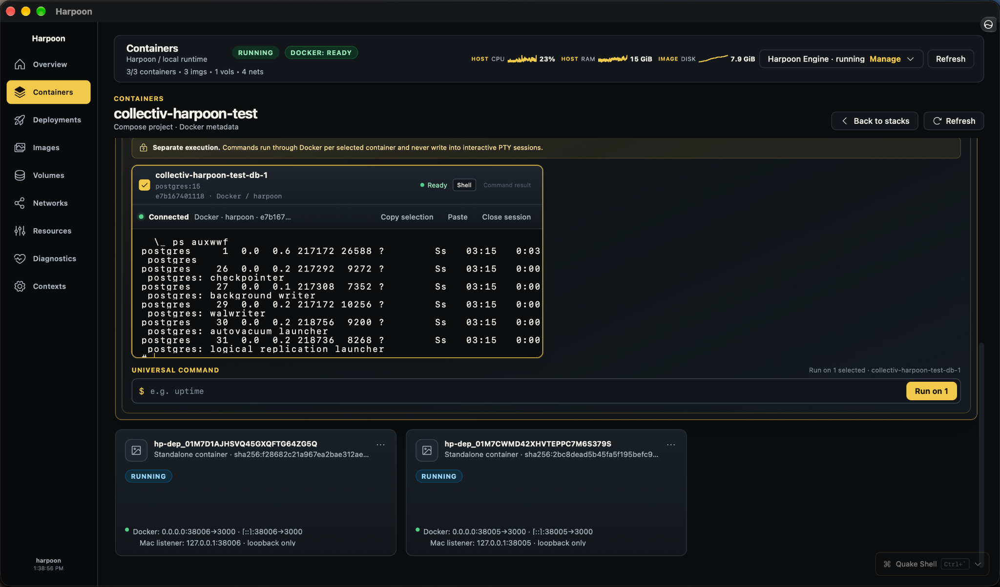

The same workspace scrolled to its shell tile. A connected session in the selected container (`ps auxwwf` inside a `postgres:15` container) is shown with Copy selection, Paste and Close session controls. The **Universal Command** field runs one command on the selected containers.

---

## Source deployments

Unreleased 2.0.1 branch work. Deployments are attended and local; the screens below show recorded state, not a hosted service.

### Deployment projects

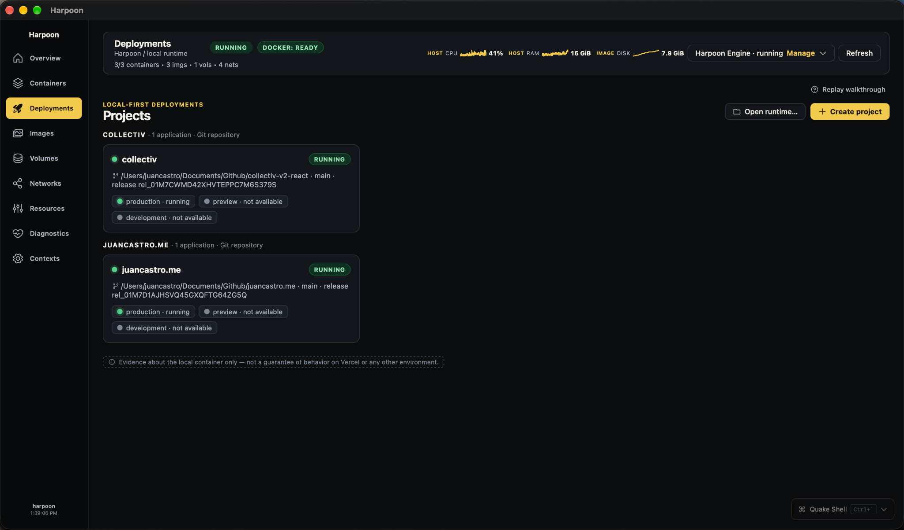

The project list: two applications, each registered from a Git repository and running in Production. The Preview and Development environments are shown as "not available" in this build. A note on the page says the evidence concerns the local container only. **Create project** and **Open runtime…** start a new application or open another runtime read-only.

### Deployment overview

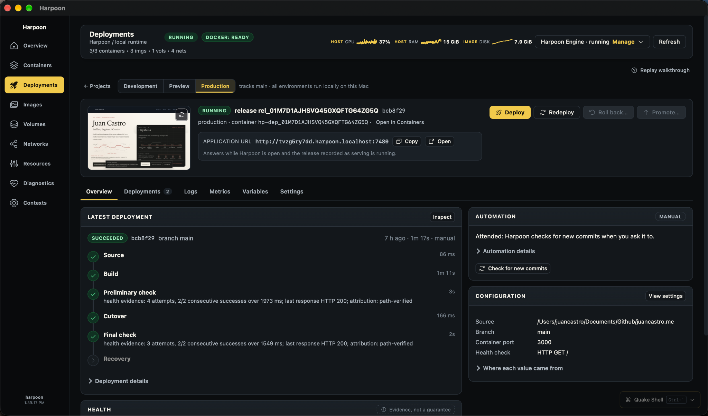

One application. The release header shows the running release, its commit, the local address (with Copy and Open), a captured preview of the running app, and the Deploy, Redeploy, Roll back and Promote actions (the last two disabled here). Below, the latest deployment's stages (source, build, preliminary check, cutover, final check) carry the recorded health evidence. Automation is attended ("Harpoon checks for new commits when you ask it to"), and detailed evidence is behind expandable sections.

### Deployment history

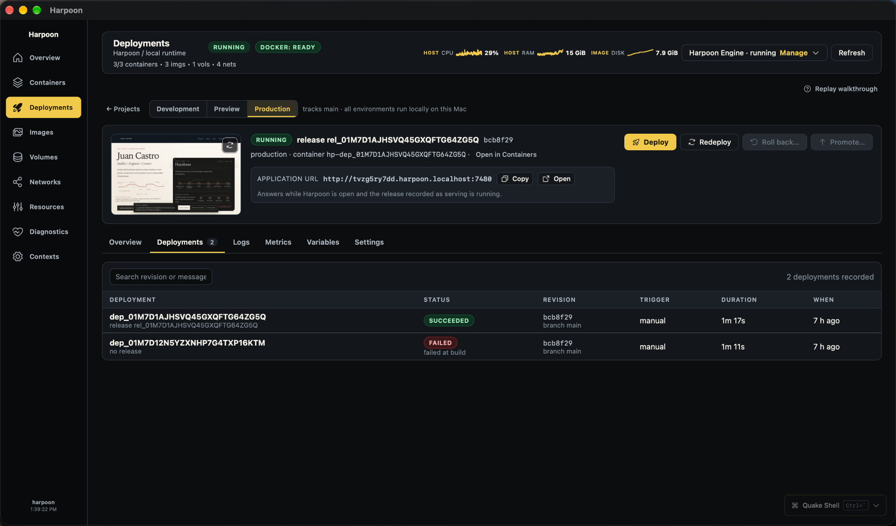

Every recorded deployment with its status, revision, trigger and duration. Here one succeeded and an earlier one failed at the build step and produced no release. Selecting a row opens its timeline, logs and recorded Docker objects.

### Variables

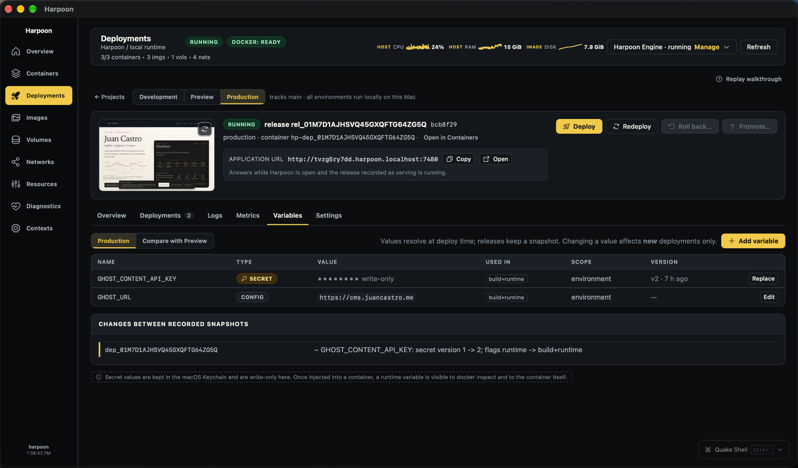

Variables for the Production environment. A **secret** is write-only: its value is masked and kept in the macOS Keychain, and only a version number is shown. A **config** value is shown in the clear. Changing a value affects new deployments only, and the recorded changes between deployment snapshots are listed below.

### Settings

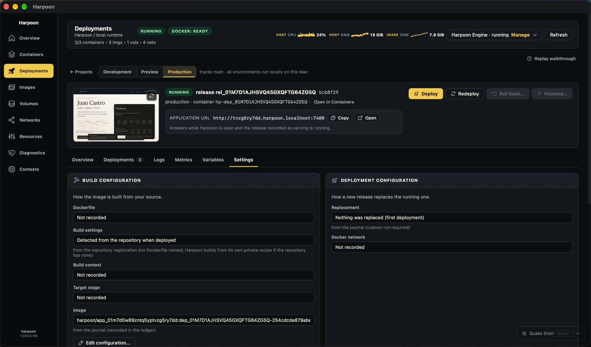

Read-only configuration for the application, grouped by purpose (build, deployment, and further down the page source, network, health checks and a Danger zone). Each value says where it came from, and a value that nothing recorded reads "Not recorded" instead of being filled in with a default. **Edit configuration…** changes the registration and deploys nothing.

---

## Operations and metrics

### Container metrics

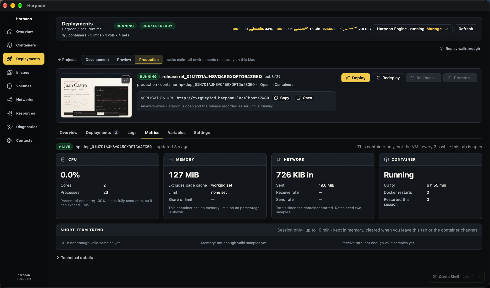

Live measurements for the container serving the release, read from Docker's own statistics for that container (after its labels and recorded id are verified), not for the VM. CPU is a percent of one core, memory excludes page cache and shows no percentage unless the container has its own limit, and network shows cumulative totals; rates appear after two samples. Sampling is about every 3 seconds while the tab is open. The short-term trend keeps up to 10 minutes in memory for the session only and says when there are not enough samples yet.

---

## Images, networking, and resources

### Images

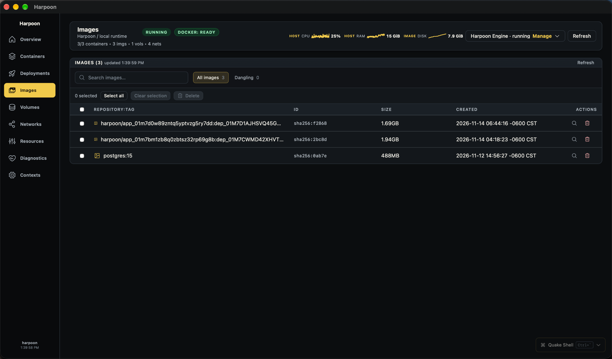

Docker's image inventory: the images built for the two deployed applications and `postgres:15`, with ID, size and creation time, search, a dangling-image filter, and selection for deletion.

### Network topology

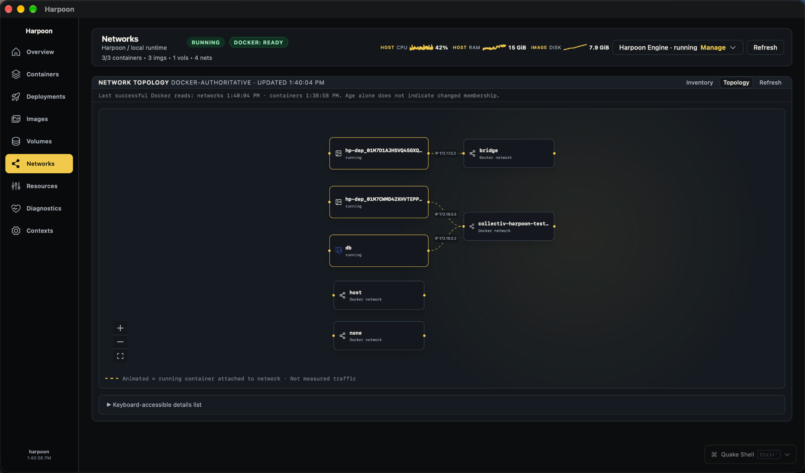

Containers and the Docker networks they are attached to, drawn from Docker's own data with the time of the last successful read. Animated links mean a running container is attached to a network; they do not show measured traffic. A keyboard-accessible details list and an Inventory view are alongside.

### Resources and Docker artifact cleanup

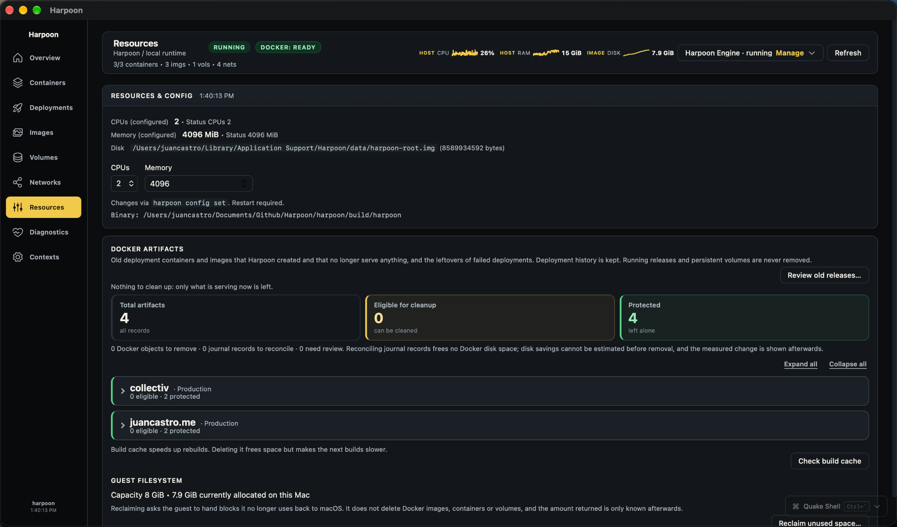

Runtime CPU and memory settings and the root disk image, then **Docker artifacts**: old deployment containers and images that Harpoon created, summarized as total, eligible and protected and grouped by application. Nothing is removed without a separate confirmation; here nothing is eligible and the running releases are protected. The page also offers a build-cache check and **Reclaim unused space**, which asks the guest to return unused blocks to macOS and reports the measured result afterwards.

---

## Engine discovery

### Contexts

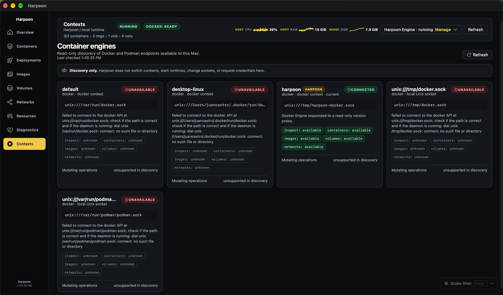

Read-only discovery of container-engine endpoints available to this Mac. The `harpoon` Docker context is connected; the others (the default context, another Docker context and two local sockets) are unavailable on this machine, with the connection error shown. Harpoon does not switch contexts, start runtimes or change sockets from this view, and mutating operations are marked unsupported in discovery.

---

[← Back to the Harpoon README](../../README.md)
