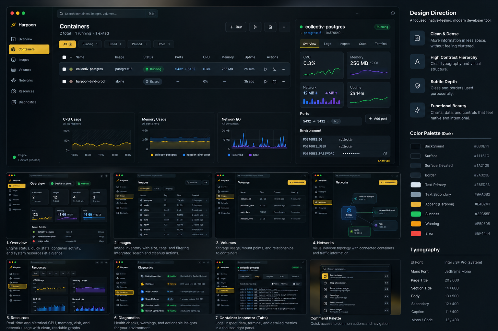
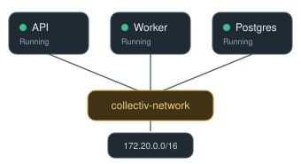

## Harpoon 2.0 — Committed Design References

These assets establish the visual and interaction direction for Harpoon 2.0. They are **design references, not implemented application screenshots or authoritative runtime specifications**.

### 1. Harpoon 2.0 — Visual Design Concept

**File:** [`assets/harpoon-2/harpoon_v2_concept.png`](assets/harpoon-2/harpoon_v2_concept.png)

Primary reference for:

- Dark graphite palette with restrained yellow accents
- Typography, iconography, spacing, borders, and elevation
- Consistent navigation and workspace layouts
- Compact operational metrics and data visualizations
- Responsive container management and contextual inspection

**Known limitation:** The main composition assumes an unusually wide window. Implementation must adapt to ordinary laptop dimensions. Large container-page graphs should instead become compact status-bar metrics linking to Resources.

### 2. Harpoon 2.0 — Network Topology

**File:** [`assets/harpoon-2/harpoon_network_topology.svg`](assets/harpoon-2/harpoon_network_topology.svg)

Primary reference for:

- Visualizing networks and their attached containers
- Interactive relationships between infrastructure objects
- Consistent node styling and connection rendering
- Contextual navigation to container and network details

**Design constraint:** Connections must represent actual engine-reported network attachments, not inferred traffic or fabricated relationships.

### 3. Harpoon 2.0 — Containers / Stacks Gallery

**File:** [`assets/harpoon-2/harpoon_stacks_gallery.html`](assets/harpoon-2/harpoon_stacks_gallery.html)

Reconstructed static design reference for the agreed Stacks view:

- vertically scrolling responsive stack-card gallery
- Compose projects and standalone containers remain distinct
- stable per-container status segments
- compact network and volume relationships
- stack body navigation into the selected stack rather than a permanent split view

### 4. Harpoon 2.0 — Stack / Container Tiles

**File:** [`assets/harpoon-2/harpoon_stack_collectiv_tiles.html`](assets/harpoon-2/harpoon_stack_collectiv_tiles.html)

Reconstructed static design reference for entering one stack:

- stack gallery is replaced by that stack's container-tile grid
- breadcrumbs/back navigation preserve the parent Stacks mental model
- container tiles expose identity, status, resources, ports and contextual actions
- operational relationships remain engine-derived rather than inferred

**Provenance note:** These two HTML files are reconstructed design artifacts based on the agreed October 2026 Harpoon 2 container-workspace design. They are preserved as visual references, not claimed as recovered originals or implemented UI.

### Reference Authority

Visual references guide aesthetics, layout, and interaction design. The existing Harpoon implementation, supported engine capabilities, and canonical roadmap remain authoritative for runtime functionality.

See [Container Workspace Specification](harpoon-2-container-workspace-spec.md) for agreed behavior and acceptance criteria.